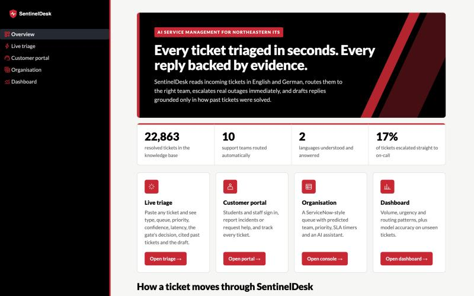
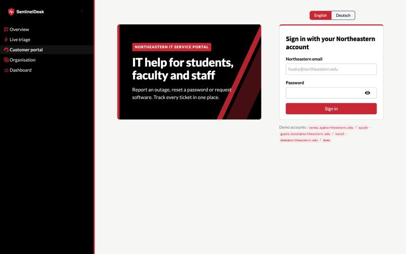
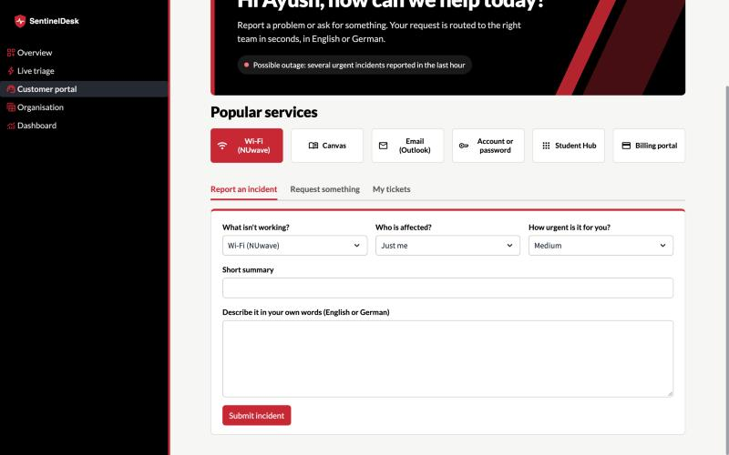
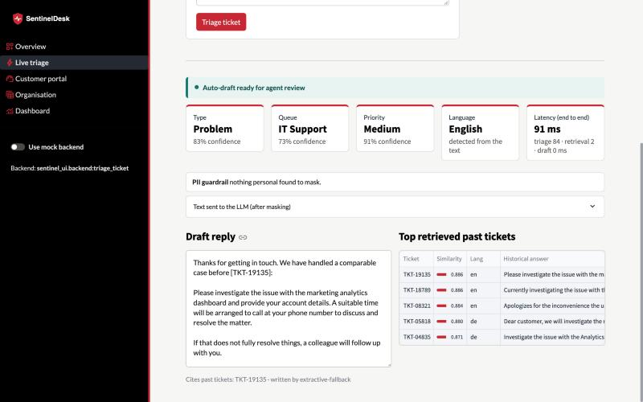
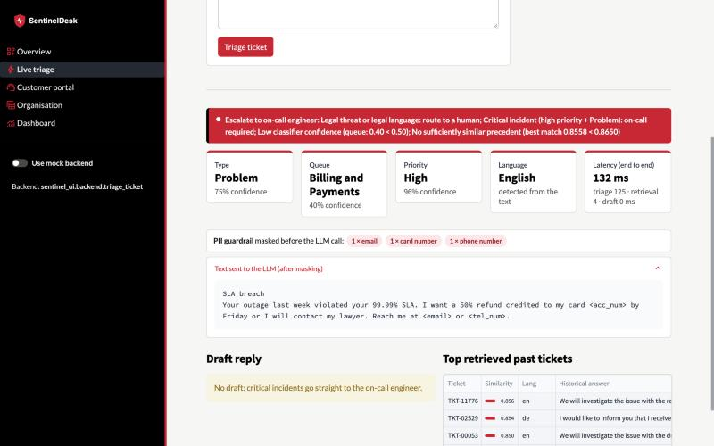
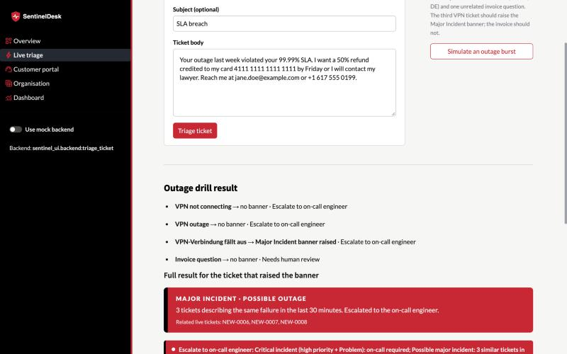
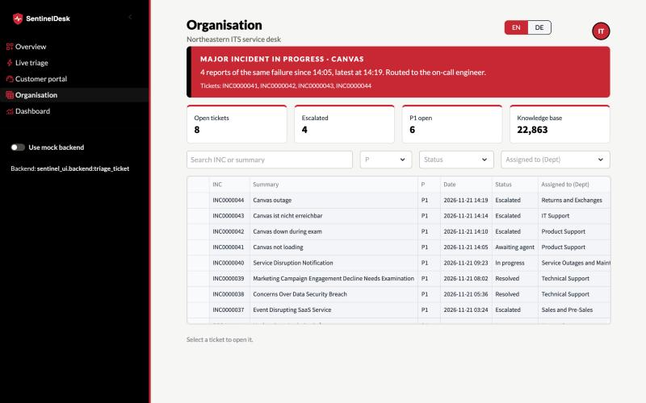
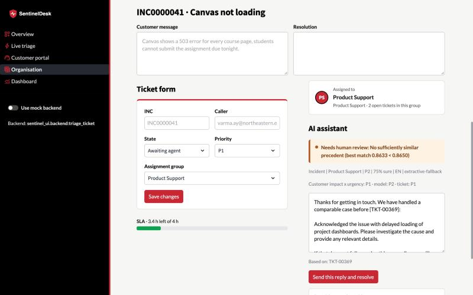
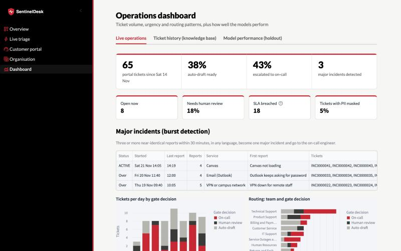

# SentinelDesk

**AI incident triage and grounded reply copilot for an IT service desk, in English and German.**

Help desks fail in two ways: urgent outages sit in the same inbox as routine questions, and AI auto-replies
invent refunds, SLAs and fixes nobody promised. For every incoming ticket, SentinelDesk:

1. **Triages it:** predicts type, team (queue) and priority, each with a confidence score.
2. **Gates it:** deterministic rules decide between auto-draft, human review and the on-call engineer, and say why.
3. **Finds precedents:** retrieves the most similar resolved tickets, across both languages.
4. **Drafts a grounded reply** in the customer's language that cites those tickets and invents nothing.

It also detects outages (a burst of similar tickets raises a Major Incident banner) and masks personal data before
any text reaches the LLM.



## Quick start

Needs Python 3.12, about 2 GB of disk space, and around 10 minutes the first time.

```bash
git clone https://github.com/ayushvarma7/SentinelDesk.git && cd SentinelDesk
./run.sh setup     # venv, dependencies, dataset, 80/20 split, classifier, retrieval index
./run.sh demo      # a realistic week of tickets, then the console on http://localhost:8501
```

Optional: put a Gemini key in `.env` for LLM drafts (`cp .env.example .env`). Without it, drafts quote the closest
past resolution instead, and everything else works the same.

| Command | What it does |
|---|---|
| `./run.sh setup` | Creates `.venv`, installs `requirements.txt`, downloads the dataset from Hugging Face, makes the official seed-42 split, trains the classifier, builds the retrieval index. Skips steps that are already done (`FORCE=1` redoes them). |
| `./run.sh test` | Contract, gate, adversarial, root-cause and status tests. |
| `./run.sh eval` | Holdout metrics, attack table, retrieval check and draft quality, all written to `reports/`. |
| `./run.sh seed` | Replays a week of portal tickets through the real pipeline, including VPN, Outlook and Canvas outages. |
| `./run.sh app` | Starts the console. |
| `./run.sh demo` | Runs `seed`, then `app`. Run it right before presenting, so the Canvas outage is live. |

## How to use it

### Sign in

Open **Customer portal** in the sidebar and sign in with a demo account. These are demo accounts in
`sentinel_ui/common.py`, not real Northeastern logins.

| Email | Password |
|---|---|
| `varma.ay@northeastern.edu` | `ayush` |
| `gupta.kunal@northeastern.edu` | `kunal` |
| `demo@northeastern.edu` | `demo` |



### Raise a ticket (Customer portal)

Users can file only **Incidents** (something is broken) or **Requests** (I need something). Problems and Changes are
raised by IT from incidents.

1. **Report an incident:** pick the service (or click a tile), who is affected, how urgent it is, then describe it
   in English or German. **Request something:** pick a category and describe it.
2. Submit. You get a number like `INC0000045`, plus either "sent to the on-call team" or the team it was routed to.
3. **My tickets** lists your tickets and their status. The pill in the banner turns red during an outage.



### Inspect any ticket (Live triage)

This is the page for judges and operators. Paste any ticket, or pick one of 15 samples (outage, German billing,
prompt injection, GDPR deletion, PII, emoji-only…). The subject is optional. One click shows:

- type, queue and priority with confidence, the detected language, and end-to-end latency with a breakdown;
- the gate's badge: **Auto-draft ready**, **Needs human review** or **Escalate to on-call engineer**, with every reason;
- what the PII guardrail masked, and the exact text the LLM receives;
- the top-5 retrieved tickets (ticket ID, similarity, historical answer) and the cited draft.




**Outage drill:** "Simulate an outage burst" sends three reports of one VPN failure (English, English, German) and an
unrelated invoice question. The third VPN report raises the Major Incident banner; the invoice does not.



### Work the queue (Organisation)

The service-desk view: every portal ticket with its priority (P1–P3), state and team, and a red banner while a major
incident is in progress. Open a ticket to change its state, priority or team. The SLA timer runs on the priority
(P1 4 h, P2 8 h, P3 24 h). The AI assistant shows the gate's decision and the draft. **Send this reply and resolve**
closes the ticket, and an edited reply becomes a precedent future tickets can cite.




### See the patterns (Dashboard)

- **Live operations:** gate outcomes, SLA breaches, detected major incidents, arrivals per hour (outage spikes in red),
  routing by team, and who files what.
- **Ticket history:** the knowledge base by team, type, priority and language.
- **Model performance:** the holdout metrics below.



## How it works

```
subject + body
  │
  ├─ PII guardrail ──── emails, phones, IPs, IBANs, cards, account numbers → <email> <tel_num> <acc_num> …
  ├─ Embed ──────────── multilingual-e5-small, "query:" prefix
  ├─ Classify ───────── word TF-IDF ‖ e5 embedding → LogisticRegression per head (type, queue, priority, language)
  ├─ Retrieve ───────── cosine over the 22,863-ticket KB index, top 5, one slot reserved for the other language
  ├─ Burst / root cause  ≥3 similar tickets in 30 min → Major Incident; similar live issues → raise a Problem
  ├─ Gate ───────────── deterministic rules → AUTO_DRAFT_READY | HUMAN_REVIEW | ESCALATE_ONCALL + reasons
  └─ Draft ──────────── Gemini on the masked text, JSON with cited IDs, then verified in code
                        (no key or a failure → extractive fallback that quotes the closest precedent)
```

| Stage | How | Why |
|---|---|---|
| Triage | TF-IDF (1–2 grams) next to the e5 embedding; one `LogisticRegression(C=32, class_weight="balanced")` per head. Priority is `high` when P(high) ≥ 0.25. | Calibrated probabilities that the gate can threshold, about 20 ms per ticket, minutes to train. The 0.25 threshold trades a little macro-F1 for catching urgent tickets. |
| Retrieval | Exact cosine in numpy over e5 `passage:` vectors; a queue filter only when it leaves enough candidates; near-duplicate answers dropped. | 1 ms per query and no faiss/torch clash on macOS. e5 does not bridge languages on its own, so one slot is reserved for the best other-language precedent. |
| Gate | On-call: high priority + Incident/Problem, P(high) × P(Incident/Problem) ≥ 0.20, outage + urgency words, a burst, a shared root cause. Human review without a draft: prompt injection, credential requests, destructive bulk actions, legal threats, refunds no precedent supports, empty text. Human review with a draft: queue confidence < 0.50, best precedent < 0.865, mean top-3 < 0.845. | Every rule is explainable in one line on the badge. No LLM decides escalation. Thresholds were tuned on a KB validation slice, never the holdout. |
| Draft | The prompt fences the ticket as untrusted data. Code then checks that every cited ID was retrieved and that every figure (%, currency, time) appears in a precedent; an ungrounded draft escalates. | The prompt alone is not the guarantee; the code checks are. |
| Learning loop | An agent-edited resolution becomes a `LIVE-…` precedent immediately; unedited AI drafts are never indexed. | Answers grow with use without the system learning from its own output. |

## Results

**Holdout:** 5,718 unseen tickets from the official 20% split, never used to choose any setting (`./run.sh eval`).

| Metric | Value |
|---|---|
| Macro-F1: type / queue / priority / language | **0.878 / 0.611 / 0.620 / 0.967** |
| Calibration (ECE): type / queue / priority | 0.028 / 0.012 / 0.082 |
| High-priority Incident recall (n = 995): predicted high | **0.852** |
| High-priority Incident recall: escalated by the gate's hard rule | 0.850 |
| Full pipeline (200 holdout tickets): high-priority Incidents escalated | **0.902** |
| Full pipeline: auto-drafted share / latency p50 / p95 | 39.5% / 180 ms / 1.2 s |
| Drafts: cite a real ticket / fake citations / invented figures / placeholder leaks | 100% / 0 / 0 / 0 |
| Drafts: in the language the customer wrote in | 100% |
| Attack table (26 adversarial and look-alike tickets + the burst scenario) | **27/27** |

The queue is the hard head: 10 classes, 21× imbalance, and overlapping teams (Technical, Product and IT Support).
Priority uses a recall-oriented threshold on purpose, because a missed outage costs more than a false alarm.

## Data and leakage

- **Dataset:** `Tobi-Bueck/customer-support-tickets`, file `aa_dataset-tickets-multi-lang-5-2-50-version.csv`
  (28,587 tickets; English 57%, German 43%), split with the organisers' seed-42 80/20 snippet.
- **The holdout is written as two files.** Inputs (`ticket_id`, `subject`, `body`) and labels are separate; only
  `scripts/evaluate.py` reads the labels.
- **Training and retrieval use the KB split only.** Classifier, thresholds and gate settings come from the 80% KB split;
  tuning uses a 10% slice of it. Only KB answers are indexed or shown.
- **No 20k CSV.** The 20k file is never mixed in, because it shares 8,399 bodies with the main file.
- **Demo data uses holdout inputs only.** `seed_demo.py` takes subject and body from the holdout, never labels or answers.

## Repository

```
app.py, views/, sentinel_ui/   Streamlit console (Live triage, portal, organisation, dashboard)
src/sentineldesk/              pipeline: pii, embed, classify, retrieve, rootcause, burst, gate, generate
scripts/                       prepare_data, train_classifier, build_kb_index, evaluate, attack_table,
                               gate_sweep / gate_calibrate, retrieval_check, draft_eval, seed_demo
tests/                         contract, gate, adversarial, root cause, status
reports/                       every number above, as JSON / CSV / Markdown
run.sh                         setup, test, eval, seed, app, demo
```

**Further reading:**
- [docs/SUBMISSION.md](docs/SUBMISSION.md): each hackathon requirement and how we met it.
- [docs/technical.md](docs/technical.md): the detailed reference.
- [docs/architecture.html](docs/architecture.html): the architecture write-up.
- [docs/p1_workdone.md](docs/p1_workdone.md) and [docs/p3_workdone.md](docs/p3_workdone.md): per-track notes.
